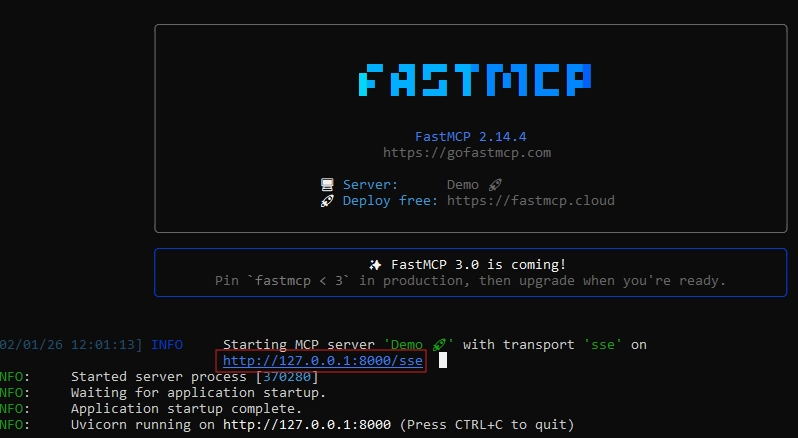
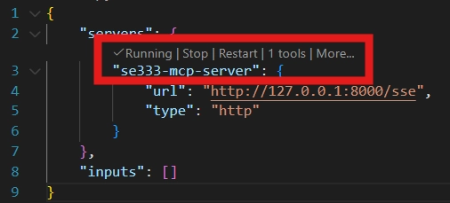
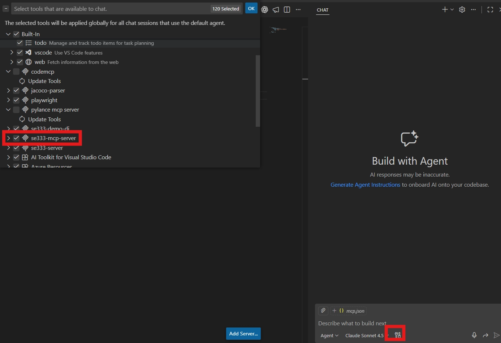
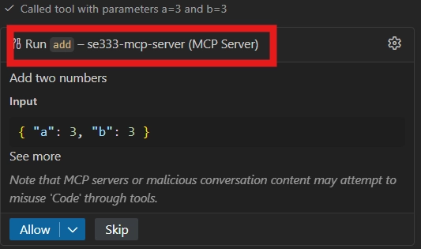
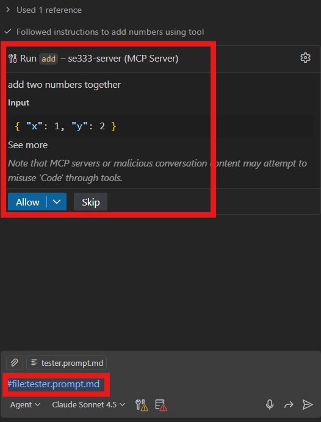
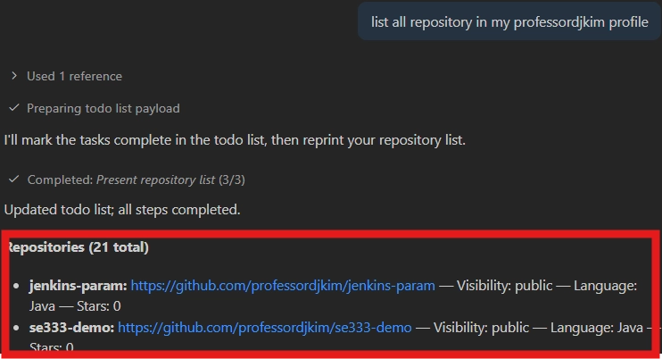
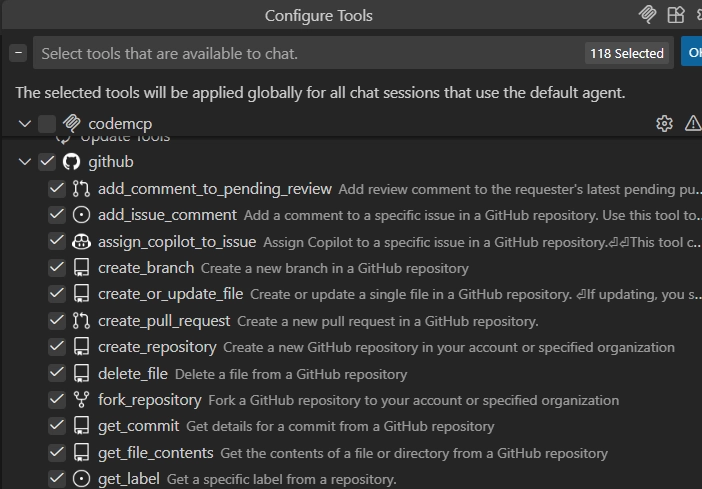

# Final Project!
**DePaul University · Spring 2026**

- Please enter your team name [Team 9]
- Please enter your member name and ID [Allen Espinosa , Kaamil Khan, Tammy Sanchez]

## Table of Contents

- [Motivation for final project](#motivation-for-final-project)
- [What do we hope to gain from this project?](#what-do-we-hope-to-gain-from-this-project)
- [Team and Deadline](#team-and-deadline)
- [Project Overview & Breakdown](#project-overview--breakdown)
- [Sprint1: Foundations and MCP Setup](#sprint1-foundations-and-mcp-setup) - Tentative - due May 4th
    - [Phase 1: Environment Setup & Create Basic MCP Server](#phase-1-environment-setup--create-basic-mcp-server)
    - [Phase 2: Create a new VSC project](#phase-2-create-a-new-vsc-project)
    - [Phase 2: Agentic Test Generation and Iterative Improvement](#phase-2-agentic-test-generation-and-iterative-improvement)
    - [Phase 3: Git Automation Tools](#phase-3-git-automation-tools)
- [Sprint2: Application to test (LLM-enabled system)](#sprint2-application-to-test-llm-enabled-system) - Tentative - due May 25th
- [Sprint3: Final Deliverables & Presentation](#sprint3-final-deliverables--presentation) - Tentative - due June 4th

## Motivation for final project

The rapid advancement of Artificial Intelligence, particularly Large Language Models (LLMs), is transforming how software is developed, tested, and maintained. Modern software systems are increasingly AI-enabled, requiring engineers to master new tools and methodologies that go beyond traditional programming and testing practices.

This project is explorative. It is designed for you to play around with the evolving landscape by integrating agentic AI, software testing, and DevOps practices into a unified, hands-on learning experience.

> **Note:** You are encouraged to fully leverage Large Language Models throughout this project. You may use LLMs for ideation, coding, debugging, test generation, documentation, research, and design decisions. Think of LLMs as collaborative development partners. However, you remain responsible for validating their outputs, ensuring correctness, maintaining academic integrity, and documenting how AI tools were used in your workflow.
> 

## What do we hope to gain from this project?

### 1. Bridging Theory and Practice

Students apply concepts from software testing, AI, and automation to build a real-world system that generates, executes, and refines tests autonomously. This bridges classroom knowledge with industry-relevant skills.

### 2. Learning Through Autonomous Systems

Instead of writing tests manually, students design agents that:

- Generate test cases,
- Execute them automatically,
- Analyze coverage feedback, and
- Iteratively improve software quality.

This introduces students to **agentic workflows**, a paradigm at the forefront of AI-driven development.

### 3. Advancing Responsible and Reliable AI

As AI systems become integral to software applications, ensuring their reliability is critical. This project emphasizes rigorous testing of both traditional software components and LLM-enabled systems, promoting trustworthy and dependable AI solutions.

## Team and Deadline

You will build an intelligent agent using the Model Context Protocol (MCP) that automatically generates, executes, and iterates on test cases to achieve maximum code coverage. This project combines AI-assisted development with traditional software engineering practices.

- **Deadline: TBA** (sometimes in June)
- **Presentation (demo)**: **TBA** (sometimes in June)
- **Team Size**: **Individual** or up to **5 people**
- **Programming Languages**: Python, Java (Maven projects)
- **Tools**: VS Code, Node.js, Git, Maven, JaCoCo, or anything that your heart desires
- Note: For each sprint, please create and maintain a separate Git branch. For example, `sprint1`, `sprint2` and `sprint3`.

---

# Project Overview & Breakdown

To promote iterative development and continuous feedback, this project is organized into **three structured sprints**. Each sprint builds upon the previous one, mirroring real-world Agile software engineering practices.

| Sprint | Title | Description | Expected Outcome |
| --- | --- | --- | --- |
| **Sprint 1** | Foundations and MCP Setup | Configure the development environment, implement MCP tools, and design an agent capable of generating and refining tests. | A functioning MCP server, prompt-driven agent, and automated test generation pipeline. |
| **Sprint 2** | Application to Test (LLM-Enabled System) | Extend and test an LLM-enabled Spring Boot chatbot. Apply the testing agent and research strategies for evaluating LLM behavior. | A fully functional LLM-enabled system with automated testing and a justified evaluation methodology. |
| **Sprint 3** | Final Deliverables and Presentation | Finalize automation, documentation, reproducibility, and presentation of results. | A polished, reproducible, and well-documented AI-assisted software engineering project. |

Below shows the breakdown of evaluation for each sprint. For more detail evaluation criteria for each sprint, please check `requirement` section for each sprints.

| Category | Weight | Description | Related Sprint(s) |
| --- | --- | --- | --- |
| **LLM-Enabled System Design & Implementation** | 30% | Implements and extends a meaningful LLM-enabled application using prompt engineering, memory, RAG, or tool integration. Demonstrates clear real-world value. | Sprint 2 |
| **LLM-Based Test Generation** | 30% | Develops an agent that generates, executes, evaluates, and refines tests using LLMs. Demonstrates iterative improvement through coverage feedback. | Sprint 1 & Sprint 2 |
| **Software Engineering Quality & Architecture** | 10% | Demonstrates clean, modular, scalable design with proper error handling, logging, and separation of concerns. | All Sprints |
| **Test, Evaluation, and Metrics** | 10% | Provides rigorous quantitative and qualitative evaluation, including traditional code testing and LLM behavior assessment. | Sprint 2 |
| **MCP Server and Prompt Integration** | 10% | Fully integrates MCP tools, Git automation, and prompt-driven workflows.  | Sprint 1 |
| **Documentation, Presentation, and Reproducibility** | 10% | Includes comprehensive documentation, reproducible setup instructions, and a professional presentation. | Sprint 3 |
| **Total** | **100%** | — | — |

# Sprint1: Foundations and MCP Setup
> Note: For each sprint, please create and maintain a separate Git branch. For this sprint, name your branch `sprint1`.

## Objective

Environment setup and MCP integration. Please read about [What is the Model Context Protocol (MCP)? - Model Context Protocol](https://modelcontextprotocol.io/docs/getting-started/intro).

## Phase 1: Environment Setup & Create Basic MCP Server

### Prerequisites

- **VS Code** (latest version) with **Chat view**
- **Node.js 18+** (LTS recommended)
- **Git** and active GitHub account
- **Java 11+** and **Maven 3.6+**

### Requirement

1. **Development Environment Configuration**
    - Install and configure `uv` package manager
    - Set up Python virtual environment with MCP dependencies
    - Configure VS Code with MCP server integration
2. **Basic MCP Server Implementation**
    
    Run the following commands from your project folder:
    
    
    ```bash
    # Create a new project
    uv init
    
    # Create and activate a virtual environment
    uv venv
    source .venv/bin/activate   # Windows: .venv\Scripts\activate
    
    # Install MCP + FastMCP dependencies
    uv add "mcp[cli]" httpx fastmcp
    ```
    
3. **First MCP Server** 
    
    Visit [fastmcp on GitHub](https://github.com/jlowin/fastmcp). Following instruction from Github, add the snippet to your main.py:
        
        ```python
        from fastmcp import FastMCP
        
        mcp = FastMCP("Demo 🚀")
        
        @mcp.tool
        def add(a: int, b: int) -> int:
            """Add two numbers"""
            return a + b
        
        if __name__ == "__main__":
            # IMPORTANT: Use SSE transport so VS Code can connect via URL.
            mcp.run(transport="sse")
        ```
        
        > **Important:** `transport="sse"` is required so your server exposes an endpoint that VS Code can connect to
        > 
    Starter your MCP server. For example, in your terminal, run:
            
        bash
        python server.py
        
            
    You should see logs indicating the server is running. Your server will be available at: `http://<machine-ip>:8000/sse` as shown below:
                

    Connect the MCP server to VS Code.
    
    While the server is still running:
    - In VS Code, press `CTRL+SHIFT+P`
    - Search: `MCP: Add Server`
    - Paste your server URL: `http://<machine-ip>:8000/sse`
    - When prompted for a name, enter: `se333-MCP-server`
    - Press `Enter`. Then, VSCode will open `mcp.json`
    - Should show that the server is running shown below
        
            
    Confirm the tool is available in VS Code Chat
    - Open the **Chat** view in VS Code
    - Click the **tool icon** (tools/providers panel)
    - Find your server `se333-mcp-server` and make sure it is **enabled/active**
        
            
    
    Test the tool
    - In the VS Code Chat prompt, type:
            
        ```
        what is 1+2 // The tool should return the correct result.
        ```
            
    - You should see a response indicating the **tool was invoked** to compute the result
            
        
        
        > This confirms that the language model successfully accessed and used the tool to perform the calculation, rather than relying solely on its internal reasoning
        > 
    Enable **YOLO** Mode (Auto-Approve). 
        
    > **Why do we enable this?** By default, VS Code **asks for your confirmation every time** the language model wants to use a tool (for example, calling an MCP server, running tests, or invoking `mvn`). While this is safer, it quickly becomes disruptive during development and experimentation.
    > 
    - Press `CTRL+SHIFT+P` → search for `Chat: Settings`
    - Enable `Auto-Approve`
    - Confirm your tools are highlighted/approved for use
    
    
## Phase 2: Create a new VSC project
    
Now that your **MCP server is running,** you will create a **separate VS Code project** .

This project acts as the **client workspace** where the agent runs and calls your MCP server tools.

1. Call this new project `se333-demo`
2. Open this folder in **VS Code**
    
    > This separation is intentional:
    > 
    > - The **MCP server** lives in one project
    > - The **agent + code under analysis** live in another project
    > - This mirrors real-world usage, where tools are shared across multiple repositories
3. **Add a prompt file for your agent**
    - We add a **dedicated agent prompt file** because it turns your **instructions into configuration** that is:
        - version-controlled
        - reproducible
        - and reusable across machines and teammates; rather than being hidden in chat history
4. In the root of your repo, create this folder:
    - `.github/prompts`
    - Inside the folder `prompts`, create a new file named:
        - `tester.prompt.md`
    - This file will define:
        - how your agent behaves
        - which tools it can use
        - and what tasks it is responsible for
    - For example, use this template as a starting point:
        
        ```markdown
        ---
        tools: ["se333-server/add"]
        description: "description of the tool"
        model: GPT-5.2
        ---
        ## Follow instruction below: ##
        1. Add 1+2
        ```
        
5. **Some background about the prompt file**
    - The **YAML header** defines *how the agent runs*:
        - `tools`: which MCP tools it may call
            - Replace tool with your actual tool name(s)
        - `model`: which model to use
    - The **Markdown body** defines *what the agent should do*:
        - Goals
        - Constraints
        - Step-by-step instructions
    - Replace:
        - the description + instructions with your custom agent behavior
    - The above instruction is `1+2`
6. You can now execute this prompt file by calling the prompt file inside the chat mode. See below:
    
    
        

---

## Phase 2: Agentic Test Generation and Iterative Improvement

### Objectives

Implement an **iterative improvement cycle** where your testing agent repeatedly generates, executes, and refines tests to **increase coverage over multiple generations**. The system should use coverage feedback to decide what to improve next.

### Requirement

1. **Agent prompt engineering**
    - Create `.github/prompts/tester.prompt.md`
    - Define the agent’s behavior for:
        - Test generation
        - Test execution
        - Coverage parsing
        - Iteration strategy (“*what to do next*” based on results)
    - Implement a clear feedback loop driven by coverage results (e.g., JaCoCo XML).
2. **Automated test improvement loop**
    - Implement a multi-iteration pipeline that:
        - Identifies coverage gaps (uncovered methods/lines/branches)
        - Generates or improves tests targeting those gaps
        - Re-runs the test suite automatically
        - Records coverage improvement **per iteration**
        - Handles failures:
            - If generated tests fail, the agent should attempt debugging and regeneration/fixes
3. **Bug exposure and fix workflow**
    - If the application contains a bug, the agent should fix it
    - If your generated tests expose the bug:
        - The agent must produce a fix (code change)
        - The fix must be validated by re-running tests
        - The fix must be committed to GitHub with a meaningful message
4. **Prompts you may use as a starter**
    
    ```markdown
    ---
    mode: tester-agent
    tools:
      - #jacoco-parser
    description: You are an expert software tester. Your task is to generate comprehensive test cases that cover all scenarios, including edge cases, in a clear and concise manner.
    ---
    
    ## Follow instructions below: ##
    1. Write test code.
    2. Run `mvn test` to ensure all tests pass.
    3. If a test fails, debug the code and fix the issues.
    4. After running the tests, find the `jacoco.xml` file in `target/site/jacoco`.
    5. Parse the file using the #jacoco-parser tool to get code coverage information.
    6. Use the coverage information to identify untested parts of the code.
    7. Write additional test cases to cover those untested parts.
    8. Iterate until you achieve 100% coverage.
    ```
    
5. You can now test whether your prompt works by testing it on assignment code

---

## Phase 3: Git Automation Tools

### Objectives

In this phase, you will **operationalize version control for AI-assisted development**. Your goal is to integrate Git automation directly into your testing agent using MCP tools, ensuring that **every AI-generated or AI-modified change is traceable, reviewable, and reproducible.** 

### Required Git MCP Tools

> To get Git MCP tools, install on [github/github-mcp-server: GitHub's official MCP Server](https://github.com/github/github-mcp-server?tab=readme-ov-file). You will wire these tools into your testing agent and apply them intentionally within a trunk-based workflow
> 
1. You may have to grant permission to Github to add this MCP server
2. To check whether MCP server is added, you could try the prompt below
    
    
3. Github MCP server has many tools as shown below
    
    
    
    - Your goal is to utilize these tools, add it to your prompt to simulate **trunk-based branching model**
4. Example of a prompt you can try:
    
    ```markdown
    1. Initialize Git (if needed). If the current directory is not already a Git repository, initialize a new Git repository.
    2. Configure Remote Repository.
       - Add <your-github-repository> as the `origin` remote.
       - If an `origin` remote already exists, replace it.
    3. Ensure Trunk Branch
       - Ensure the trunk branch is named `main`.
       - Do not commit directly to `main`.
    4. Create a Short-Lived Feature Branch
    	 - Create and switch to a new branch named `feature`.
    5. Commit and Push Changes... <TODO>
    6. Create Pull Request... <TODO>
    7. Merge to Main Branch .. <TODO>
    ```
    
5. Once you execute the prompt above, it will automatically utilize GitHub API to fulfill tasked listed

### Requirement

- Integrate Git MCP tools into your `tester.prompt.md`
- Any code or test changes introduced by the agent must:
    - Be tracked via Git
    - Be auditable through commits
    - Integrate Git MCP tools into your `tester.prompt.md`
- **Design & Experimentation Requirement**
    - You are expected to **experiment with and reason about different automation strategies**, including (but not limited to):
        - Whether pull requests should be created **immediately** or **batched**
        - Whether pull requests should be **merged automatically** or require manual approval
        - Whether additional **quality gates** should be enforced (e.g., merge only after CI passes)
        - How much autonomy the agent should have versus human oversight
- There is no single correct configuration. Your goal is to **explore trade-offs** and justify your choices

---

# Sprint2: Application to test (LLM-enabled system)
> Note: For each sprint, please create and maintain a separate Git branch. For this sprint, name your branch `sprint2`.

### Objective

Apply everything you have learned by testing a small application written in Java, while practicing disciplined, AI-assisted development and version control

### Requirements

- Design and implement your own original web application (written in SpringBoot, since we are working in Java)
    - Your goal is to clone the [SE333DePaul/llm-enabled-se](https://github.com/SE333DePaul/llm-enabled-se/tree/main)
    - Please read the `readme.md` to understand the functionality of the repository
    - In general, this repository provides a ChatBot using LLM
        - Your goal is to provide several extension to this repository of your choice
- Use **Git** consistently to track development progress:
    - Every meaningful improvement (feature change, test improvement, bug fix and test generation) must be recorded as a commit.
    - Push commits to GitHub regularly (treat GitHub as the source of truth)
- After extending the system, apply the testing agent you developed in the **previous sprint** to test the application. However, you should recognize an important limitation. The agent developed so far mainly tests traditional program functionality, not the quality or behavior of the LLM itself.
- Therefore, part of this **sprint** is exploratory and research-oriented:
    - Investigate how LLM-enabled systems should be tested beyond conventional unit and integration testing.
    - Consider questions such as:
        - How would you evaluate whether the chatbot’s answers are correct, helpful, safe, or robust?
        - What kinds of failures are unique to LLM-based systems?
        - What testing strategies, metrics, or evaluation workflows could be used to assess LLM behavior?
    - You are expected to propose and justify a testing strategy for the LLM-enabled aspects of your system.

---

# Sprint3: Final Deliverables & Presentation
> Note: For each sprint, please create and maintain a separate Git branch. For this sprint, name your branch `sprint3`.

### Documentation Requirements

1. **Features you will be evaluated on:**
    - Whether your system truly iterates (multiple cycles with measurable improvement)
    - Whether Git history clearly reflects progression (code → tests → coverage → fixes → metrics)
    - Whether your agent uses feedback (coverage + failures) to make better decisions over time
    - Whether your changes are auditable on GitHub
2. **Technical Documentation in readme.md** 
    - Complete MCP tool API documentation
    - Installation and configuration guide
    - Troubleshooting and FAQ section
3. **Live or Video Demonstration depending on sync or async (5 minutes)**
    1. What is in the demonstration?
        - Demonstrate the LLM-enabled system you built
        - Explain how your workflow works.
            - You do not necessarily need to show real life demo, but you could refer the code you wrote
        - Coverage improvement showcase
        - Show most impressive features
    2. Sync student: Need to be in-person presentation
    3. Async student: Only video recording

---

## Submission Guidelines

### Final Submission

All deliverables must be submitted via GitHub repository with:

- Complete source code with clear organization
- Comprehensive README with setup instructions
- Documentation in markdown format
- Video demonstration uploaded to course platform
- Reflection report as PDF

**Late Policy**: NO late policy

**ANSWERS**
[TEAM 9]
[Allen Espinosa [21677088] , Kaamil Khan[2093700], Tammy Sanchez[]

https://github.com/SE333DePaul/final-project-team-9 

Final Project Documentation
Team Information
Team Name: Team 9
Member: Kaamil Khan [2093700], Allen Espinosa [2167088], Tammy Sanchez []
 
•    Project Summary
This project is an LLM-enabled Spring Boot chatbot application that was extended, tested, and documented as part of the final SE333 project. The goal of the project was to explore how Large Language Models can be integrated into a software system and how AI-assisted testing workflows can be used to improve software quality.
The application is based on a chatbot system that accepts user messages and returns responses using an LLM. Several new features were added to make the application more useful and testable, including input validation, chat modes, feedback submission, and response summarization. These features helped turn the original chatbot into a more complete LLM-enabled system with real application behavior that could be tested and evaluated.
 
•    Features Implemented
Chatbot Endpoint
The main chatbot feature allows a user to send a message to the application and receive a response from the LLM. This is the core feature of the system and was used as the base for the other extensions.
Input Validation
Input validation was added to prevent invalid or overly long messages from being processed. Messages longer than the allowed limit are rejected by the application. This improves reliability because the system can handle bad input instead of sending everything directly to the LLM.
Chat Modes
Chat modes were added so the chatbot could respond in different ways depending on the selected mode. The supported modes include:
●    Default mode
●    Java tutor mode
●    Debug helper mode
●    Scheduling assistant mode
This feature shows how prompt engineering can change the behavior of an LLM-enabled system.
Feedback Endpoint
A feedback feature was added so users can mark whether a chatbot response was helpful and optionally leave a comment. This provides a way to collect information about the quality of the chatbot’s responses.
Summary Endpoint
A summary feature was added so users can submit text and receive a summarized version of the message. This extends the chatbot beyond basic conversation and demonstrates another practical LLM use case.
 
•    Repository Structure

Main Branch: Contains the final version of the project sprints together as one

Sprint1 Branch: implements 
-    MCP Server setup
-    FastMCP implementation
-    VS Code MCP configuration
-    Testing agent development
-    JaCoCo coverage analysis
Sprint2 Branch: Implements
-    LLM-enabled chatbot enhancements
-    Automated testing
-    Evaluation strategy
Branches in Sprint2
1.    feature/chat-feedback – Adds user feedback functionality.
2.    feature/input-validation – Adds validation for user input.
3.    ChatMode-features – Implements multiple chatbot interaction modes.
 
•    MCP Testing Agent
The project used an MCP-based testing agent to support AI-assisted software testing. The testing agent was designed to generate tests, run the test suite, review test results, and improve tests based on feedback.
The testing workflow followed this general process:
1.    Identify the application features that needed testing.
2.    Generate or improve tests for those features.
3.    Run the Maven test suite.
4.    Review failures or missing coverage.
5.    Improve the tests or application code when needed.
6.    Commit meaningful changes to GitHub.
The testing agent was particularly useful for traditional software testing tasks such as endpoint validation, request and response verification, and automated test improvement.
 
•    MCP TOOL API Documentation
-    MCP server uses FastMCP to help with tools that can be used through VS Code and AI agents.
-    Tool: add
1.    Purpose is to add two integers together.
2.    The parameters are a(int) and b(int) that should return the sum (example would be add(1,2) -> 3
•    Testing Agent Integration
The MCP agent is used to:
1.    Generate test cases
2.    Execute Maven tests
3.    Examine failures of tests
4.    Analyze coverage reports
5.    Improve tests iteratively
•    GitHub MCP Integration
The GitHub MCP tools were an aid to help:
1.    Branch creation
2.    Commit tracking
3.    Pull request workflows
4.    Repository Management

 
•    Testing Approach
The project used two different types of testing:
Traditional Application Testing
Traditional tests were used to verify the behavior of the Spring Boot application. These tests focused on application logic and endpoint behavior. The tests checked that:
●    The chatbot endpoint returns a response.
●    Invalid or overly long input is rejected.
●    The feedback endpoint accepts valid feedback.
●    Different chat modes are handled correctly.
●    The summary endpoint returns a response.
●    The application does not fail when expected inputs are provided.
These tests are important because they confirm that the application itself works correctly.
LLM Behavior Evaluation
Testing an LLM-enabled system is different from testing a normal program. A normal unit test can compare the output of a method to one exact expected value. However, an LLM can produce different valid responses for the same input. Because of this, exact word-for-word assertions are not always a good testing strategy for chatbot responses.
Instead of testing the LLM only through exact output matching, the chatbot was evaluated using qualitative criteria. The LLM responses were reviewed based on whether they were:
●    Relevant to the user’s input
●    Helpful and understandable
●    Safe and appropriate
●    Consistent with the selected chat mode
●    Reasonable for the intended feature
This approach made more sense because the quality of an LLM response depends on meaning and usefulness, not just exact wording.
 
•    Test Results and Evaluation
The application was tested using Maven. All major application features performed as expected during testing. The chatbot endpoint responded successfully, input validation rejected overly long messages, feedback submission worked, chat modes changed the behavior of the chatbot, and the summary endpoint returned summarized output.
The testing process showed that automated tests are useful for confirming the structure and behavior of the application. However, automated tests alone cannot fully prove that every LLM response is correct, helpful, or safe. For that reason, the final evaluation used both automated testing and manual review of LLM responses.
Combining automated testing with manual LLM evaluation provided a more comprehensive testing strategy because it covered both the software side of the system and the LLM behavior side of the system.
 
•    Git and Version Control
GitHub was used throughout development to track project progress, manage feature branches, and maintain a complete history of changes. Meaningful changes were committed as the project was developed, including application features, testing changes, documentation updates, and project improvements.
This made the project easier to review because the development history shows the progression from the original application to the final LLM-enabled system.
 
•    Installation and Configuration Guide 
-    Java 21
-    Maven
-    Python 3.10+
-    Node.js 18+
-    Visual Studio Code
-Clone Repository
git clone https://github.com/SE333DePaul/final-project-team-9.git 
-Install Dependencies
mvn clean install
-Start MCP Server
python server.py
-Run Application
mvn spring-boot:run
-Run Tests
mvn test

 
•    How to Run the Application
From the project directory, run:
mvn spring-boot:run

Then open the application in the browser using the local server address shown in the terminal.
 
•    How to Run Tests
From the project directory, run:
mvn test

This command runs the automated test suite for the Spring Boot application.
 
•    Troubleshooting and FAQ
Maven command does not work
Make sure Maven is installed and available from the terminal. Run:
mvn -version

Application does not start
Check that the correct project folder is open and that all required dependencies are included in the pom.xml file.
Chatbot does not return a response
Check that the LLM configuration is set correctly. If the application depends on an API key or environment variable, make sure it is available before running the application.
Tests fail because of LLM response wording
LLM responses can vary, so tests should avoid depending on exact word-for-word chatbot responses unless the output is fully controlled. A better approach is to test status codes, response structure, non-empty responses, and expected application behavior.
 
